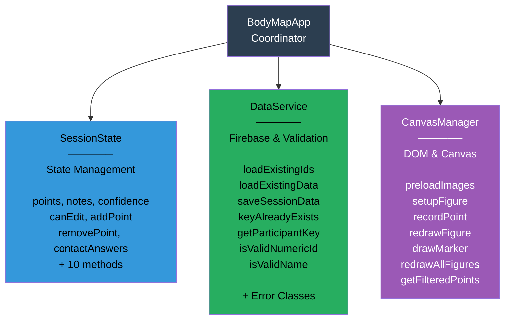
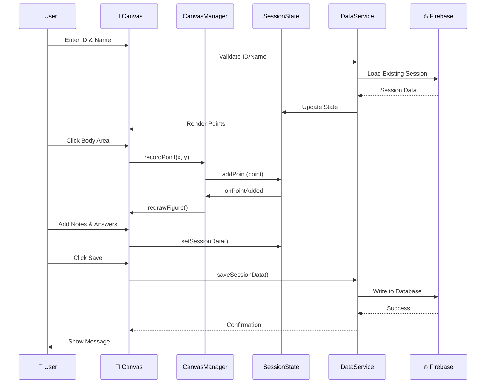

# Physical Interaction Body Map Application

A web-based interactive body mapping tool for recording and analyzing physical interactions.

---

## Architecture Overview

### High-Level Architecture Diagram



### Data Flow Diagram

```mermaid
graph LR
    User["👤 User<br/>(Browser)"]
    Canvas["🎨 Canvas<br/>(HTML5)"]
    Manager["CanvasManager<br/>(Drawing)"]
    State["SessionState<br/>(State)"]
    Service["DataService<br/>(Firebase)"]
    DB["🔥 Firebase<br/>(Database)"]
    
    User -->|Click/Touch| Canvas
    Canvas -->|Event| Manager
    Manager -->|recordPoint| State
    Manager -->|redraw| Canvas
    State -->|on Change| Manager
    State -->|Save| Service
    Service -->|Read/Write| DB
    Service -->|Validate| State
    
    style User fill:#f39c12,stroke:#e67e22,stroke-width:2px
    style Canvas fill:#3498db,stroke:#2980b9,stroke-width:2px
    style Manager fill:#9b59b6,stroke:#8e44ad,stroke-width:2px
    style State fill:#3498db,stroke:#2980b9,stroke-width:2px
    style Service fill:#27ae60,stroke:#229954,stroke-width:2px
    style DB fill:#c0392b,stroke:#a93226,stroke-width:2px
```



### User Workflow Sequence Diagram



---

## Components Overview

### 1. **SessionState**
Pure state management class for the user session.

**Properties:**
- `collectedPoints[]` - Array of recorded interaction points
- `idIsValid` - Boolean flag for participant ID validation
- `nameIsValid` - Boolean flag for participant name validation
- `isExistingSession` - Whether loading an existing session
- `firstEntryTimestamp` - Timestamp of earliest point
- `canEdit` - Whether session is still editable (1-hour window)
- `editStatusTimer` - Timer reference for edit window countdown
- `sessionNotes` - Participant notes
- `sessionConfidence` - Confidence rating (1-5 stars)
- `questionnaireResponses` - Object with questionnaire answers (q1-q4)
- `contactAnswers` - Yes/no answer of each contact section (`{ touched_by, touched }`, each "yes", "no" or null). Only a "no" is saved, as the trial's `noContactTouchedBy` / `noContactTouched`; a "yes" shows in the areas drawn

**Methods:**
- `addPoint(point)` - Add point to collection
- `removePoint(index)` - Remove point by index
- `clearAllPoints()` - Clear all points
- `hasPointsInDirection(direction)` - Check if points exist for direction
- `getPointsCount()` - Get total points count
- `setSessionData(notes, confidence)` - Update notes and confidence
- `setQuestionnaireResponse(questionKey, value)` - Update single question
- `getUnansweredItems()` - Get list of unanswered questions
- `reset()` - Reset entire session to initial state

---

### 2. **DataService**
Centralized Firebase database operations and validation.

**Constructor:**
- `constructor(firebaseDb)` - Initialize with Firebase database reference

**Properties:**
- `db` - Firebase database reference
- `existingKeys` - Set of existing participant IDs

**Methods:**

**Validation:**
- `isValidNumericId(id)` - Validate ID format (digits only)
- `isValidName(name)` - Validate name is not empty
- `getParticipantKey(id, name)` - Generate unique key from ID and name
- `keyAlreadyExists(id, name)` - Check if participant already in database

**Firebase Operations:**
- `async loadExistingIds()` - Load all existing participant keys from Firebase
- `async loadExistingParticipantData(id, name)` - Load session data and points
  - Returns: `{ exists: bool, points: [], earliestTimestamp: null, sessionData: {} }`
- `async saveSessionData(id, name, notes, confidence, questionnaire, collectedPoints)` - Save session to Firebase

**Error Handling:**
- Throws `DataLoadError` on load failures
- Throws `DataSaveError` on save failures
- Throws `ValidationError` on validation failures

---

### 3. **CanvasManager**
All canvas drawing and user interaction handling.

**Constructor:**
- `constructor(figureConfigs, directionColors, appState)` - Initialize with configs and state

**Properties:**
- `figureConfigs` - Array of figure configurations
- `directionColors` - Color mapping for directions
- `appState` - Reference to SessionState
- `imageCache` - Cached SVG images (internal)
- `canvases` - Map of canvas elements (internal)
- `contexts` - Map of canvas 2D contexts (internal)

**Methods:**

**Image & Setup:**
- `async preloadImages()` - Preload all SVG images into cache
- `setupFigure(figureConfig)` - Setup canvas with event listeners (click, touch, wheel)

**Drawing:**
- `redrawFigure(figureConfig)` - Redraw single figure with points
- `redrawAllFigures()` - Redraw all 4 figures
- `drawMarker(ctx, x, y, direction)` - Draw point marker dot
- `getFilteredPoints()` - Get points filtered by current display filter

**Interaction:**
- `recordPoint(figureId, x, y)` - Record new point with validation
  - Validates ID/name, edit window, marking mode
  - Normalizes coordinates
  - Supports both click and touch events

**Touch Handling:**
- Click detection
- Touch detection with 10px move threshold (prevents accidental points while scrolling)
- Wheel event blocking

---

### 4. **Custom Error Classes**

```javascript
class DataLoadError extends Error  // Firebase load failures
class DataSaveError extends Error  // Firebase save failures
class ValidationError extends Error // Input validation failures
```

Each provides:
- `.name` property for error type identification
- `.message` for detailed error message
- Console logging with error classification

---

## Features

### Core Functionality
- **Interactive Body Mapping** - Click/touch body figures to record interactions
- **4 Body Views** - Front, back, left, and right views
- **Directional Tracking** - "I touched" vs "I was touched" distinction
- **Questionnaire Integration** - 4-question survey embedded in interface

### Data Management
- **Participant Sessions** - Create new or load existing sessions
- **Persistent Storage** - Firebase Realtime Database integration
- **Edit Window** - 1-hour edit period with countdown
- **Session Notes** - Add participant notes with star confidence rating
- **Data Validation** - Multi-level validation (ID, name, questionnaire, points)

### User Experience
- **Real-time Feedback** - Points appear immediately on figures
- **Separate Contact Sections** - "Being touched by others" and "Touching others", each with its own yes/no question and its own set of figures
- **Touch Optimization** - Smart touch handling with scroll detection
- **Responsive Design** - Works on desktop and mobile
- **Error Handling** - Clear error messages with retry capability

### Code Quality
- **Modular Architecture** - Separation of concerns across 3 classes
- **Custom Error Classes** - Proper error classification and handling
- **Image Caching** - Eliminated redundant network requests
- **Clean State Management** - All state centralized in SessionState
- **Documented API** - Each method has clear purpose

---

## Technical Stack

- **Frontend** - HTML5, CSS3, Vanilla JavaScript (ES6+)
- **Canvas** - HTML5 Canvas API for drawing
- **Database** - Firebase Realtime Database

---

## Usage

### For Participants

1. **Enter ID and Name**
   - ID must be numeric
   - Name cannot be empty
   - System checks if you're a new or returning participant

2. **Declare Contacts**
   - Answer the two yes/no questions: "your body was touched by other participants" and "you touched other participants"
   - On "Yes", that section shows its own figures: draw (or tap) the contact areas there
   - Each section lists its own areas: edit their ratings, delete one, or clear them all
   - Answering "No" after drawing asks for confirmation, then deletes that section's areas
   - Saving requires both questions answered, and at least one area for each "Yes"

4. **Add Session Data**
   - Enter optional notes
   - Rate confidence level (1-5 stars)
   - Answer all 4 questionnaire items

5. **Save Session**
   - Click "Save and Send"
   - Data saved to Firebase
   - Confirmation message appears

### For Returning Participants

1. Enter your ID, the Trial number and the last letter of your family name
2. System loads the answers you sent for that trial **today** (the same ID and trial number on another day start a new, empty trial)
3. You have 1 hour to edit your session
4. Continue where you left off

Correcting the ID, trial number or letter after answering keeps the answers not sent yet: they move to the corrected trial. If the corrected fields point at a trial already sent today, the answers stay on the page but can't be sent there (they would replace the sent ones) until the fields are corrected again.

Trials are stored per day under `data/{id}_{letter}_{YYYY-MM-DD}/trials/{trialNumber}` (local date of the device), so experiment days that reuse the same IDs and trial numbers never read or overwrite each other. `{letter}` is the last letter of the participant's family name, lower-cased: a participant who mistypes their ID only reaches someone else's answers if that person's family name also ends with the same letter.

### Languages

The page is shown in German by default; participants can switch to English with the buttons at the top, and the choice is remembered on their device. All displayed texts live in `translations.js` (one entry per text, with its `en` and `de` versions side by side). Answers are saved as language-neutral codes (e.g. `strongly_agree`), and each trial also records the page language it was sent in (`language: "de"` or `"en"`).

---

## Data Model

### Point Object
```javascript
{
  participantId: "123",
  participantName: "john doe",
  figure: "front",
  direction: "touched_by",
  xNorm: 0.45,              // 0-1 normalized X coordinate
  yNorm: 0.32,              // 0-1 normalized Y coordinate
  timestamp: "2025-12-12T10:30:00.000Z"
}
```

### Session Data Object
```javascript
{
  notes: "Participant notes...",
  confidence: 4,            // 1-5
  questionnaire: {
    q1: 2,
    q2: 3,
    q3: 1,
    q4: 4
  },
  lastEdited: "2025-12-12T10:35:00.000Z"
}
```

---

## API Reference

### SessionState Methods
```javascript
appState.addPoint(point)
appState.removePoint(index)
appState.clearAllPoints()
appState.hasPointsInDirection('touched')
appState.getPointsCount()
appState.setSessionData(notes, confidence)
appState.setQuestionnaireResponse('q1', 3)
appState.getUnansweredItems()
appState.reset()
```

### DataService Methods
```javascript
await dataService.loadExistingIds()
await dataService.loadExistingParticipantData(id, name)
await dataService.saveSessionData(id, name, notes, confidence, questionnaire, points)
dataService.isValidNumericId(id)
dataService.isValidName(name)
dataService.getParticipantKey(id, name)
dataService.keyAlreadyExists(id, name)
```

### CanvasManager Methods
```javascript
await canvasManager.preloadImages()
canvasManager.setupFigure(figureConfig)
canvasManager.recordPoint(figureId, x, y)
canvasManager.redrawFigure(figureConfig)
canvasManager.redrawAllFigures()
canvasManager.drawMarker(ctx, x, y, direction)
canvasManager.getFilteredPoints()
```

---

## Error Handling

### Error Types

**DataLoadError**
- Firebase connection issues
- Missing participant data
- Snapshot parsing failures

**DataSaveError**
- Firebase connection issues during save
- Permission errors
- Data format issues

**ValidationError**
- Invalid participant ID (non-numeric)
- Empty participant name
- Missing questionnaire responses
- Missing point data

### User Feedback
- Clear error messages in UI
- Console logging with error classification
- Retry capability for transient errors
- Graceful degradation

---

## Performance Optimizations

1. **Image Caching** - SVG images loaded once at startup, reused for all redraws
2. **Normalized Coordinates** - Points stored as 0-1 coordinates, responsive to canvas size
3. **Touch Optimization** - Move threshold prevents accidental points while scrolling
4. **Event Delegation** - Minimal event listeners per canvas
5. **Efficient Redraws** - Only affected figures redrawn on changes

---

## Browser Compatibility

| Browser | Support |
|---------|---------|
| Chrome  | ✅ Full |
| Firefox | ✅ Full |
| Safari  | ✅ Full |
| Edge    | ✅ Full |
| Mobile Safari (iOS) | ✅ Full |
| Chrome Mobile | ✅ Full |

---

## Development Notes

### Adding New Validation Rules
Add to `DataService.isValid*()` methods:
```javascript
isValidCustomField(value) {
  return value && value.length > 0;
}
```

### Customizing Colors
Update the `directionColors` object in `index.html`, as `#rrggbb` values. It sets the colour of the areas drawn, of their swatch in the areas list, and of each contact section's top border and instruction box:
```javascript
const directionColors = {
  touched: "#3498db",        // "Touching others" (blue)
  touched_by: "#e74c3c"      // "Being touched by others" (red)
};
```

### Extending Questionnaire
1. Add new field to `SessionState.questionnaireResponses`
2. Add UI elements in HTML
3. Add event listeners in global code
4. Update validation in `saveAllAndReload()`
5. Add the field, with its allowed values, to `database.rules.json` and deploy it (`firebase deploy --only database`)

### Database Rules
`database.rules.json` only accepts trials shaped exactly as the page saves them: the key formats above, the known fields with their allowed values (e.g. `strongly_agree`), notes up to 2000 characters, at most 100 areas, and area masks that are PNG data URIs under 300,000 characters. Any other field is refused, so a new field or answer option saved by the page needs a matching change in the rules, or saving fails.

### Modifying Edit Time Limit
Change constant at top of code:
```javascript
const EDIT_TIME_LIMIT = 60 * 60 * 1000; // milliseconds
```


---

## License

This project is provided as-is for research and clinical use.

---
